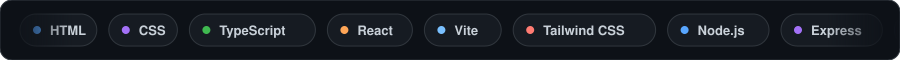
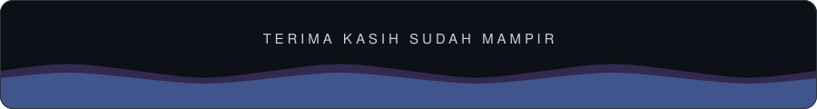

  
  
  

### Project pilihan

  
  
  

  
    Demo:
    <a href="https://catatku-eta.vercel.app">catatku</a> ·
    <a href="https://hmsdp.me">attendance</a> ·
    <a href="https://sekyurass.github.io/Portofolio/">Portofolio</a> ·
    <a href="https://github.com/Sekyurass/segara-notes">segara-notes</a> (MVP Notion-like)
  

### Aktivitas terbaru

  <picture>
    <source media="(prefers-color-scheme: dark)" srcset="assets/snake-dark.svg" />
    <source media="(prefers-color-scheme: light)" srcset="assets/snake.svg" />
    
  </picture>

### Guestbook

  

Pesan tampil setelah saya setujui.

### Statistik

  
  

  

